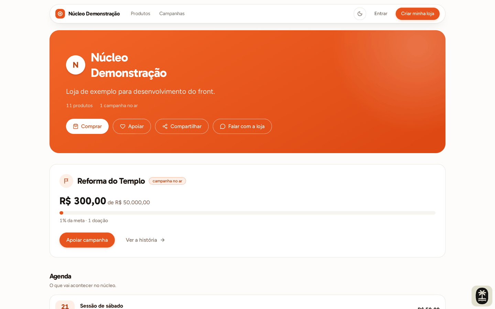
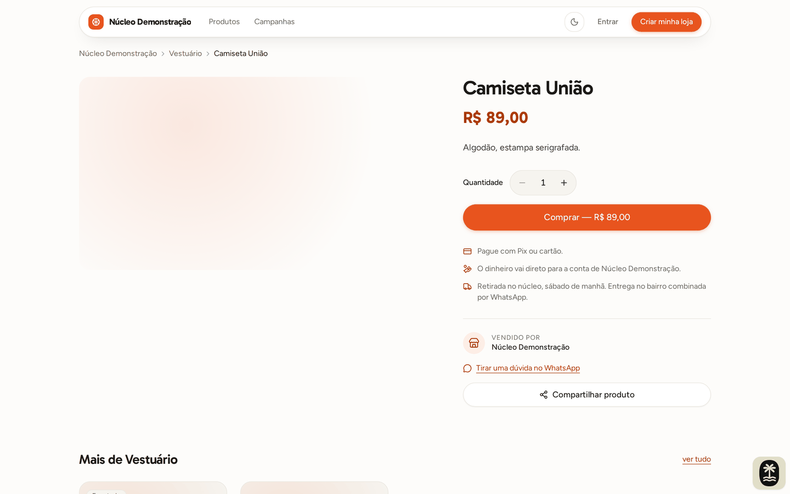
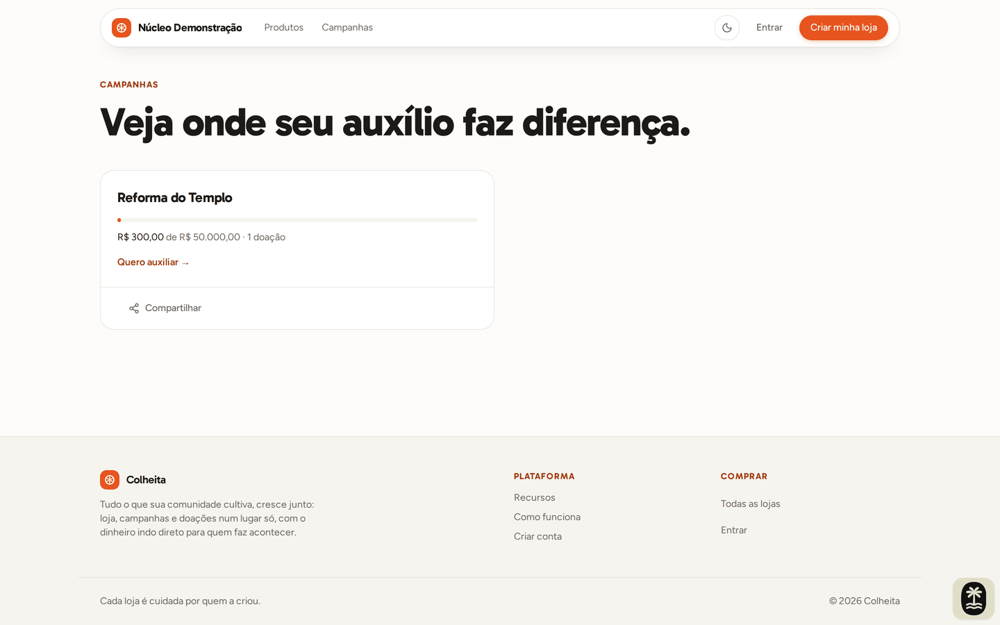
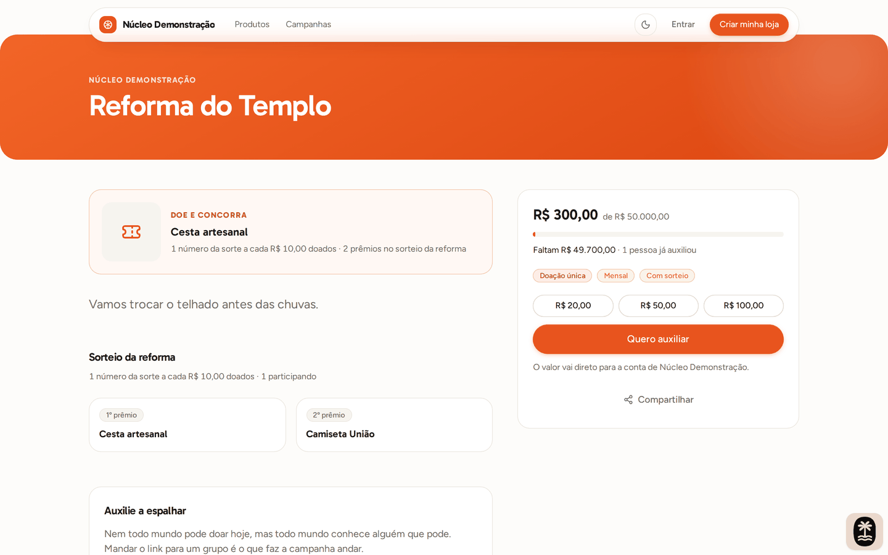
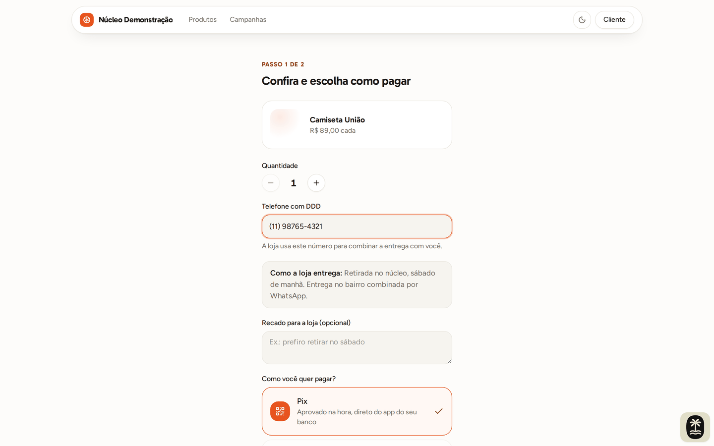
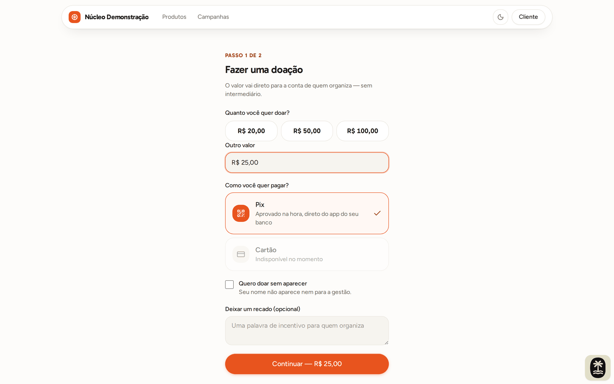
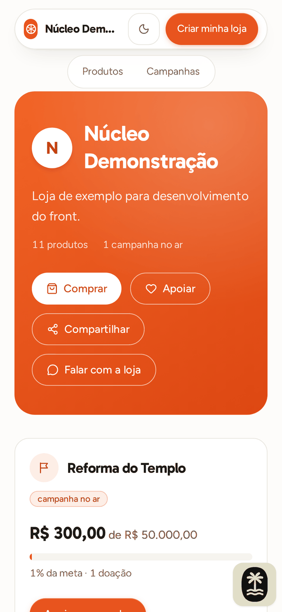
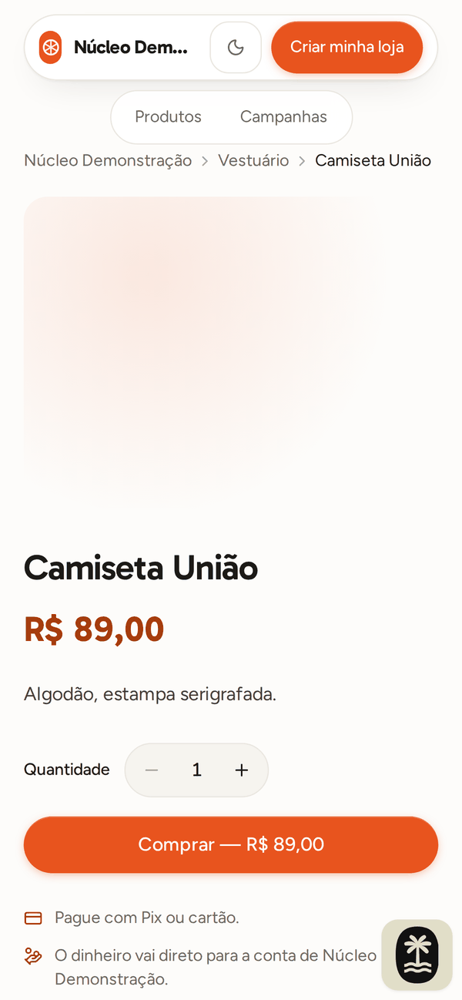
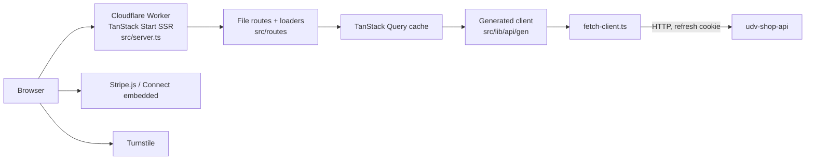

# udv-shop (web)

Web client for a community storefront: stores publish products, events, campaigns and raffles, take donations, and get paid by Pix or card.

**Status:** Portfolio project. Source is published for review; no production traffic, users or revenue are claimed here. CI is defined (check, typecheck, unit tests, build, Playwright e2e) but not currently running because of repository billing, so the numbers below were measured locally. Existing docs, mostly in Portuguese: [architecture](docs/ARCHITECTURE.md), [design](docs/DESIGN.md), [engineering case study](docs/ENGINEERING_CASE_STUDY.md), [portfolio case study](docs/PORTFOLIO_CASE_STUDY.md).

## What it does

- Public storefront: store list, store page, product pages, campaigns and events (`src/routes/loja`, `src/routes/lojas.tsx`).
- Guest and signed-in checkout for products and donations, with Pix (QR and copy-paste) and card panels (`src/components/pay`, `comprar.tsx`, `doar.tsx`).
- Store management area: products, orders, donations, campaigns, events, team, payouts, statement and settings (`src/routes/gestao/$slug`).
- Account flows: sign up, sign in, password recovery, team invitations (`entrar.tsx`, `criar-conta.tsx`, `recuperar-senha.tsx`, `convite`).
- Payment onboarding embedded in the app through Stripe Connect components (`src/components/stripe-connect-embedded.tsx`).
- Anti-bot challenge on anonymous writes (`src/components/store/captcha.tsx`).
- SEO: per-route meta, canonical links, JSON-LD, `sitemap.xml` and `robots.txt` server routes (`src/lib/seo.ts`).
- Light and dark theme with an anti-flash script (`src/lib/theme.ts`).

## Screenshots

Demo store with fictitious seed data (demo campaign, invented phone number); payments run against a fake provider, so QR codes are placeholders. Product images are placeholder gradients.

<table>
  <tr>
    <td width="50%"><br><sub>Store home with active campaign card.</sub></td>
    <td width="50%"><br><sub>Product page.</sub></td>
  </tr>
  <tr>
    <td width="50%"><br><sub>Campaigns list with progress bar.</sub></td>
    <td width="50%"><br><sub>Campaign page with donate panel and raffle prizes.</sub></td>
  </tr>
  <tr>
    <td width="50%"><br><sub>Checkout, step 1 of 2.</sub></td>
    <td width="50%"><br><sub>Donation, step 1 of 2.</sub></td>
  </tr>
</table>

<table>
  <tr>
    <td width="25%"><br><sub>Store home on mobile.</sub></td>
    <td width="25%"><br><sub>Product page on mobile.</sub></td>
  </tr>
</table>

## Architecture



- No database and no server-side session: every read and write goes to the API.
- Routes are file-based and loaders prefetch into the Query cache so SSR output hydrates without a second fetch.
- The API client and Zod schemas are generated from the API's OpenAPI document; nothing under `src/lib/api/gen` is hand-written.
- Card data never touches this app; it goes to Stripe from the browser.
- Deployed as a Cloudflare Worker (`wrangler.jsonc`).

## Key decisions

- Typed contract by codegen: Kubb reads `../udv-shop-api/docs/openapi.json` and emits types, Zod schemas, clients and hooks ([`kubb.config.ts`](kubb.config.ts)). Trade-off: the API repo must be checked out next to this one to regenerate.
- Access token kept in memory only; the refresh token is an HTTP-only cookie set by the API ([`src/lib/api/auth-token.ts`](src/lib/api/auth-token.ts), [`src/lib/auth/session.tsx`](src/lib/auth/session.tsx)). Trade-off: a page reload costs one refresh call.
- A single HTTP client owns base URL, token injection and error mapping ([`src/lib/api/fetch-client.ts`](src/lib/api/fetch-client.ts), tested in `fetch-client.test.ts`).
- Money and dates are formatted in one place, in pt-BR ([`src/lib/format.ts`](src/lib/format.ts)); payout and raffle rules that need to be exact have their own tested modules ([`payout.ts`](src/lib/payout.ts), [`raffle.ts`](src/lib/raffle.ts)).
- Card is optional: without `VITE_STRIPE_PUBLISHABLE_KEY` checkout offers Pix only ([`src/components/pay/pay-choice.tsx`](src/components/pay/pay-choice.tsx)).
- Money flows are covered by Playwright against the real API running with fake Pix payments ([`e2e/`](e2e), [`.github/workflows/ci.yml`](.github/workflows/ci.yml)).

## Tech stack

React 19, TypeScript, TanStack Start / Router / Query, Tailwind CSS v4, Radix primitives, Zod, react-hook-form, Stripe.js, Kubb, Vite, Biome, Vitest, Playwright, Cloudflare Workers.

## Getting started

Prerequisites: Node.js 22+, pnpm 10, and a running [udv-shop-api](https://github.com/mkwitko/udv-shop-api) (default `http://localhost:3333`).

```bash
cp .env.example .env     # placeholders only; see table below
pnpm install
pnpm dev                 # http://localhost:3000
```

| Variable | Purpose |
| --- | --- |
| `VITE_API_URL` | Base URL of the API, used by SSR and the browser |
| `VITE_SITE_URL` | Public origin, used in canonical, `og:url` and sitemap |
| `VITE_STRIPE_PUBLISHABLE_KEY` | Stripe publishable key; without it only Pix is offered |
| `VITE_TURNSTILE_SITE_KEY` | Turnstile site key; must be paired with the API's secret key |

When the API contract changes, regenerate the client (no codegen is committed by hand):

```bash
# in udv-shop-api
pnpm openapi:export
# in this repo, with the API checked out at ../udv-shop-api
pnpm api:generate
```

Other scripts: `pnpm build`, `pnpm typecheck`, `pnpm check` (Biome), `pnpm deploy` (build and `wrangler deploy`; not needed to run locally).

## Testing

- Unit: 13 files, 109 tests (Vitest), all passing locally.
- End-to-end: 10 Playwright spec files, 22 tests covering storefront navigation, Pix purchase, donations, product management, events, statement and payouts. They need the API seeded with the demo store and `DEV_FAKE_PAYMENTS=true`; one local run gave 20 passed, 1 failed (monthly donation toggle), 1 skipped.

```bash
pnpm check && pnpm typecheck && pnpm test && pnpm build
pnpm test:e2e            # needs the API on :3333, seeded, with fake payments
```

## Project structure

```text
src/routes/        file-based routes (public store, management, account, sitemap/robots)
src/components/    auth, pay, site, store, ui (re-themed shadcn base)
src/lib/           api client and generated code, auth, pay, format, seo, theme
src/integrations/  TanStack Query setup
e2e/               Playwright specs and helpers
docs/              architecture, design system, case studies
```

## Related repositories

- [udv-shop-api](https://github.com/mkwitko/udv-shop-api): the REST API this client consumes.

## License

All rights reserved. Source available for portfolio review.
