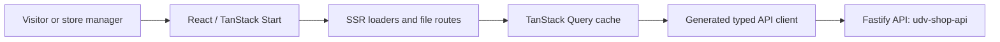

# Community Storefront — Web

A React storefront and management interface for community organizations to sell products, manage stores, and receive donations. This repository contains the **web application**; the API lives in [udv-shop-api](https://github.com/mkwitko/udv-shop-api).

> **Portfolio note:** This README describes code and workflows present in the repository. A public production deployment, customer adoption, and performance numbers have not been independently verified.

## What the project demonstrates

- **Product UX:** public landing page, store discovery, product pages, account flows, and store-management routes.
- **Modern React architecture:** TanStack Start / Router, React 19, server-side route loaders and TanStack Query.
- **Typed API integration:** Kubb-generated TypeScript clients, schemas, and query hooks from the backend OpenAPI specification.
- **Authentication model:** short-lived access token held in browser memory; refresh handled by an HTTP-only cookie issued by the API.
- **Discoverability:** route-level SEO metadata, canonical links, sitemap, and robots routes.
- **Testing:** Vitest and Playwright test tooling; the repository includes end-to-end scenarios for storefront navigation, products, checkout, donations, and management.
- **Delivery:** Cloudflare Workers configuration and a design system maintained in `docs/DESIGN.md`.

### Technical stack

| Area | Implementation |
| --- | --- |
| UI | React 19, TypeScript, Tailwind CSS v4, Radix primitives |
| Routing / SSR | TanStack Start and TanStack Router |
| Data | TanStack Query + generated API clients (Kubb) |
| Validation | Zod |
| Tooling | Vite, Biome, Vitest, Playwright |
| Hosting configuration | Cloudflare Workers |

## Architecture



The frontend intentionally has no database of its own. See [architecture documentation](docs/ARCHITECTURE.md) for SSR hydration, session boundaries, and code generation.

## Run locally

**Prerequisites:** Node.js, pnpm, and a configured instance of [udv-shop-api](https://github.com/mkwitko/udv-shop-api).

```bash
cp .env.example .env
pnpm install
pnpm dev
```

The application is configured to run at **http://localhost:3000**. Configure `VITE_API_URL` in your `.env` file; the local example points at the API on port 3333. The backend documentation includes database setup and development seed data.

### Type-safe API contract

When API schemas change:

```bash
# In udv-shop-api
pnpm openapi:export

# In this repository
pnpm api:generate
```

The generated clients live under `src/lib/api/gen/`; do not edit them manually.

## Quality and verification

Scripts provided by this repository:

```bash
pnpm typecheck
pnpm check
pnpm test
pnpm test:e2e
pnpm build
```

End-to-end scenarios require their documented environment and services; listing the commands here does **not** imply that they were executed successfully in this portfolio review.

## Further reading

- [Architecture](docs/ARCHITECTURE.md)
- [Visual design principles](docs/DESIGN.md)
- [Backend source and API documentation](https://github.com/mkwitko/udv-shop-api)

## Project media and status

Screenshots and a public demonstration have **not yet been added** to this repository README. Add only real, redacted captures of the running app; avoid personal/customer data and unsupported deployment claims. This codebase is published for inspection, but **production-readiness has not been established by this README**.
