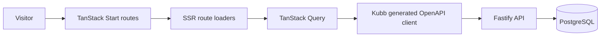

# Case study: Community Storefront Web

**Discipline:** Frontend architecture, SSR and typed API integration  
**Source:** This public repository, not an independently audited production system.

## Challenge and engineering approach

The codebase supports public store discovery, product pages and store-management flows while remaining coupled to a separately deployed [Fastify API](https://github.com/mkwitko/udv-shop-api). Its notable engineering design is the boundary between **server rendering**, **client-side data caching** and **automatically generated API contracts**.

## Inspectable design decisions

| Decision | Engineering benefit | Trade-off |
| --- | --- | --- |
| File-based routing and SSR loaders | Public data can be present in initial HTML | Must carefully partition server-only and browser-only state |
| Generated request types and query hooks | Less client/server schema drift | OpenAPI generation becomes part of the release workflow |
| HTTP-only refresh cookie + in-memory access token | Reduces token persistence in browser storage | Session restoration needs a client-side handoff |
| Dedicated design tokens/components | Consistent product UX across public and management flows | Extra discipline when adopting new UI components |
| SEO routes | Explicit sitemap, robots and page metadata | Metadata must stay synchronized with changing domain configuration |

## Evidence map

- [Project architecture](docs/ARCHITECTURE.md) — SSR, API contract, authentication and session restoration.
- [Visual system](docs/DESIGN.md) — shared design choices and constraints.
- [Public landing implementation](src/routes/index.tsx) — route loader and metadata.
- [Generated API integration](src/lib/api/) — client utilities and generated output.
- [E2E test cases](e2e/) — storefront navigation, donations, checkout and management scenarios.
- [CI source](.github/workflows/ci.yml) — quality and Playwright workflows; see current Actions runs for their actual status.

## Review walkthrough (5 minutes)

1. Open the landing route and find its route loader and SEO metadata.
2. Follow one generated query hook to the OpenAPI generation config.
3. Read the SSR hydration and session restoration sections in the architecture document.
4. Inspect one Playwright scenario to see an end-to-end flow.

## What's verified and what isn't

**Source-backed:** repository code implements the above components and workflows.  
**Not independently verified here:** live production traffic, conversion improvements, availability, Lighthouse scores, successful current CI run, and client/user adoption.

## Visual evidence backlog

- [ ] Run the application with demo/seed data and capture real, anonymized desktop and mobile screens.
- [ ] Capture the public storefront and a management workflow.
- [ ] Measure mobile Lighthouse and Core Web Vitals under stated conditions.
- [ ] Add `docs/media/` screenshots with descriptive alt text and version/date.
- [ ] Verify content and permission to share all brand/product imagery.
